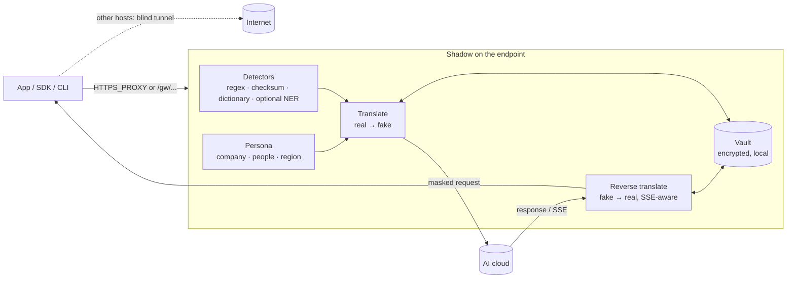

# Shadow

**Your machine talks to AI. Shadow makes sure it does so under a different name.**

Shadow is an endpoint-level privacy layer between any machine (macOS, Linux, Windows; laptops or servers) and AI clouds such as OpenAI, Anthropic, OpenRouter, Gemini, Mistral, Groq, Together, DeepSeek, xAI, Azure OpenAI, Cohere and Perplexity. It runs as a small background service. It finds the sensitive values in every outbound AI request, swaps them for realistic fakes from a persistent **persona**, and swaps the fakes back in the response. Streamed responses are translated the same way. Your tools never notice, and the provider never sees the real values.

```
you  ──"Email jane@acme.com about Project Falcon for Acme GmbH"──▶  Shadow
Shadow ──"Email hui.zhao@zhilan.cn about Velora Quilent for Zhilan Technology Co., Ltd."──▶  api.openai.com
api.openai.com ──"Sure — drafting a note to hui.zhao@zhilan.cn…"──▶  Shadow
Shadow ──"Sure — drafting a note to jane@acme.com…"──▶  you
```

Single static binary · Rust · Apache-2.0 · no cloud, no account, no telemetry.

---

## Why

- Prompts carry far more than the question: names, emails, customer lists, internal hostnames, file paths with your username, API keys pasted by accident, IBANs in an invoice.
- Policies and DLP gateways tend to *block*. Blocking breaks the tool, so people route around it.
- Shadow *translates* instead. The model still gets a coherent, realistic prompt, because a fake email is still an email and a fake IBAN still passes mod-97. You still get a useful answer back, in your own terms.

## How it works



1. **Intercept.** Shadow listens on `127.0.0.1:8877`. As an HTTPS proxy it terminates TLS only for known AI hosts, using a local CA you trust once. Every other host is tunnelled byte for byte. As a gateway (`/gw/openai/...`) it needs no CA at all.
2. **Detect.** Built-in detectors cover emails, phones, person names, street addresses, IBANs (mod-97), payment cards (Luhn), national IDs (SSN, NINO, Aadhaar), IPv4/IPv6, MACs, internal hostnames and URL hosts, API keys and tokens (OpenAI, Anthropic, GitHub, AWS, Slack, Google, JWTs, private keys, `password=…`), and usernames inside home-directory paths. A dictionary covers your organisation names, codenames, customers and projects, plus local machine facts: OS user, hostname, git `user.name` and `user.email`, local domain. An optional local PyTorch NER model can be added on top.
3. **Translate.** Each value maps to a format-preserving fake drawn from the persona. The same real value always gets the same fake, and no two reals share a fake, so reversal is unambiguous. The mapping is persisted.
4. **Scrub identifiers.** OpenAI `user` / `safety_identifier` and Anthropic `metadata.user_id` become the persona's user id. Identifying headers are stripped (`OpenAI-Organization`, `X-Forwarded-For`, `x-stainless-os`, ...) or rewritten (`X-Request-Origin` → the persona hostname).
5. **Restore.** Responses are unmasked before they reach the caller. That includes SSE streams where a fake is split across events (`"Wei"` … `" Zhang"`).

### The persona

On first run Shadow creates a persistent fake identity for the machine: company name and domain, country, city, timezone and locale, a primary person, colleagues, a username, a user id and a hostname. By default the region is picked **far from the real one**: a machine in Europe gets a persona in, say, China, Japan or Brazil. Set `[persona] region = "JP"` to choose. Your organisation name maps to the persona company, and your git identity maps to the persona's primary person.

```
$ shadow identity
◆ Persona — what AI providers see
  company         Zhilan Technology Co., Ltd. (zhilan.cn)
  person          Hui Zhao <hui.zhao@zhilan.cn>
  location        Shenzhen, China · Asia/Shanghai · zh-CN
  user id         user-b1f9a96f7997
  hostname        zhilan-dev-78
```

### The vault

The real↔fake mapping never leaves the machine. It lives in `vault.bin`, which is encrypted with ChaCha20-Poly1305. The key sits in `vault.key`, created with mode `0600`. Every write is atomic (temp file + rename) and thread-safe. Several processes can share a data dir, because each save merges the other processes' entries in first.

## Install

**macOS / Linux**

```sh
curl -fsSL https://raw.githubusercontent.com/Tiny-Bubble-Company/shadow/main/packaging/install.sh | sh
# or from source:
cargo install --locked --git https://github.com/Tiny-Bubble-Company/shadow shadow-cli
```

**Windows (PowerShell)**

```powershell
irm https://raw.githubusercontent.com/Tiny-Bubble-Company/shadow/main/packaging/install.ps1 | iex
```

**Docker sidecar**

```sh
docker build -f packaging/Dockerfile -t shadow .
docker run -d --name shadow -p 127.0.0.1:8877:8877 -v shadow-data:/data shadow
```

Building needs Rust ≥ 1.88 and nothing else: no OpenSSL, no Python.

## Quick start (60 seconds)

```sh
shadow init --org "Acme GmbH"                  # persona + vault key + local CA
echo "Mail jane@acme.com re Acme GmbH, card 4111 1111 1111 1111" | shadow mask
# → Mail hui.chen@zhilan.cn re Zhilan Technology Co., Ltd., card 4837 2191 9471 3480

shadow run                                     # foreground, 127.0.0.1:8877
OPENAI_BASE_URL=http://127.0.0.1:8877/gw/openai/v1 your-tool …   # gateway mode

shadow install            # dry run: prints exactly what would change
shadow install --apply    # LaunchAgent / systemd --user / Scheduled Task + trust CA
```

## Gateway mode vs. OS proxy mode

| | Gateway mode | OS / env proxy mode |
|---|---|---|
| How | Point the SDK base URL at `http://127.0.0.1:8877/gw/<provider>` | `HTTPS_PROXY=http://127.0.0.1:8877` or the PAC file at `/proxy.pac` |
| CA trust needed | No | Yes (`shadow install --apply`) |
| Covers | Tools that let you set a base URL | Every tool that honours proxy env vars or system proxy |
| Non-AI traffic | Not involved | Tunnelled untouched (never decrypted) |

Built-in routes: `openai`, `anthropic`, `openrouter`, `gemini`/`google`, `mistral`, `groq`, `together`, `deepseek`, `xai`, `cohere`, `perplexity`, `fireworks`, `cerebras`. Add your own, such as Azure, Bedrock or a self-hosted gateway, under `[proxy.routes]`.

For proxy mode, `shadow install` prints the environment to export:

```sh
export HTTPS_PROXY=http://127.0.0.1:8877
export NO_PROXY=localhost,127.0.0.1
export NODE_EXTRA_CA_CERTS=~/Library/Application\ Support/shadow/ca/ca.pem
export REQUESTS_CA_BUNDLE=~/Library/Application\ Support/shadow/ca/bundle.pem   # system roots + Shadow CA
export SSL_CERT_FILE=~/Library/Application\ Support/shadow/ca/bundle.pem
```

## CLI

| Command | What it does |
|---|---|
| `shadow init [--region CN] [--org "Acme GmbH"]… [--force]` | Create persona, vault key and CA (`--force` starts over) |
| `shadow run [--listen 127.0.0.1:8877]` | Foreground proxy + gateway |
| `shadow install [--apply]` / `shadow uninstall [--apply]` | Service + CA trust; dry run by default |
| `shadow status [--quiet]` | Config, persona, vault, CA fingerprint, proxy health |
| `shadow identity [--json]` | Show the persona |
| `shadow mask` / `shadow unmask` `[--json]` | stdin → stdout |
| `shadow scan <file> [--reveal] [--json]` | Report findings without changing anything |
| `shadow vault stats` · `export --i-understand` · `forget <value>` | Inspect the vault |
| `shadow terms add <term>…` · `terms list` | Protect codenames, customers, people (`person:Jane Doe`) |
| `shadow hosts` | Intercepted hosts and gateway routes |

## Configuration

`<data dir>/shadow.toml`. Every key is optional; see [`shadow.example.toml`](shadow.example.toml) for the full reference.

```toml
organization = ["Acme GmbH"]                 # first one ↔ persona company
terms = ["Project Falcon", "person:Jane Doe", "org:Globex"]
internal_domains = ["acme.com", "acme.internal"]
allow_domains = []                           # public domains never masked
allow_terms = []                             # values never masked

[persona]
region = "auto"                              # or CN, JP, KR, BR, US, DE, IN, AU, MX, ZA, CA

[detectors]
email = true                                 # … phone, person, address, iban, credit_card,
local_facts = true                           # national_id, ip, mac, hostname, secret, path

[model_detector]                             # optional local NER sidecar (ml/)
enabled = false
url = "http://127.0.0.1:8878/detect"

[proxy]
listen = "127.0.0.1:8877"
upstream_proxy = "socks5h://relay.example.net:1080"   # optional egress in persona region
strip_headers = ["openai-organization", "x-forwarded-for", "x-stainless-os"]
[proxy.persona_headers]
"x-request-origin" = "{hostname}"
[proxy.routes]
azure = "https://my-resource.openai.azure.com"
```

Data dir: `$SHADOW_HOME`, else `~/Library/Application Support/shadow` (macOS), `~/.local/share/shadow` (Linux), `%APPDATA%\shadow` (Windows).

## Embedding the library

```toml
[dependencies]
shadow-core = { git = "https://github.com/Tiny-Bubble-Company/shadow" }
```

```rust
use shadow_core::{Shadow, ShadowConfig};

let shadow = Shadow::open(ShadowConfig::from_dir("/var/lib/myapp/shadow").with_terms(vec!["Acme GmbH".into()]))?;
let masked = shadow.mask("Ping jane@acme.com about Acme GmbH");      // Masked { text, replacements, kinds }
let answer = call_llm(&masked.text)?;
let restored = shadow.unmask(&answer);

let mut body = serde_json::json!({"model": "gpt-4o", "messages": [{"role": "user", "content": "…"}]});
shadow.mask_json(&mut body);                       // masks string leaves, skips model/role/type
let mut s = shadow.stream_unmasker();              // for streamed text
let out = s.push("Hi Wei Zh") + &s.push("ang!") + &s.finish();
```

Custom detectors implement `shadow_core::Detector` and are passed to `Shadow::open_with_detectors`.

## Threat model and honest limitations

Shadow protects the **content** of AI requests from the AI provider, from anyone the provider shares data with, and from logs, training sets and breaches downstream of it. It does not make you anonymous.

- **Source IP is not hidden by translation.** Providers still see your egress IP and your API key's account. Set `upstream_proxy` to send intercepted AI traffic through a relay, for example one in the persona's region. The API key still identifies the account.
- **Detection is best effort.** Regex, checksum and dictionary detectors miss unusual formats and free-form names that aren't in the dictionary. Add terms, or enable the optional NER model in `ml/`. Run `shadow scan` on representative prompts.
- **Not scanned:** images, audio, PDFs and other binary uploads, multipart bodies, WebSocket/Realtime APIs, and gRPC. These are forwarded unchanged.
- **TLS-pinning apps** (some desktop apps, mobile apps) reject the local CA and will fail in proxy mode. Use gateway mode where possible.
- **Signed requests** (AWS SigV4 for Bedrock) can't be modified without breaking the signature. Shadow detects them and forwards them unmasked with a warning. Bedrock API keys (bearer) work.
- **Meaning can shift.** A model may reason about the fake (a persona in Shenzhen gets answers about Chinese holidays). Choose a region that suits you, or pin `region`.
- **Short, generic fakes** that a model happens to produce on its own are translated back too, which is rarely a problem.
- **The endpoint is trusted.** Anyone with your user account can read `vault.key` and the vault. Full-disk encryption is recommended.
- **The CA key is powerful.** `ca/ca.key` is created `0600`. Uninstalling removes the CA trust. Never share the data dir.

## FAQ

**Does Shadow send anything anywhere?** Only the translated requests you were already sending, to the providers you were already using. There is no telemetry.

**What happens if Shadow is down?** In gateway mode, requests fail. In proxy mode, tools fail to connect; remove `HTTPS_PROXY` to bypass. The service restarts on failure.

**Can I see what was replaced?** `RUST_LOG=info shadow run` logs counts per request, never values. `shadow vault export --i-understand` shows the mapping.

**Is the mapping reversible by the provider?** No. Fakes are random and the mapping exists only in your encrypted vault.

**Multiple machines, one identity?** Copy `persona.json`, `vault.bin` and `vault.key` to the other machine, or point several tools at one data dir.

**Can Shadow be a model?** Yes. `ml/` contains a small PyTorch token-classification model (BiLSTM + char-CNN) and a localhost sidecar. Enable `[model_detector]`. The Rust build never needs Python.

## Development

```sh
cargo test --workspace          # unit + integration tests (mock upstream, SSE, MITM)
cargo clippy --workspace --all-targets
```

Layout: `crates/shadow-core` (detection, persona, vault, translation), `crates/shadow-proxy` (CA, MITM, gateway, SSE), `crates/shadow-cli` (`shadow` binary), `ml/` (optional NER), `packaging/` (launchd, systemd, Windows, installers, Dockerfile), `docs/index.html` (documentation site).

## License

Apache-2.0. See [LICENSE](LICENSE).
