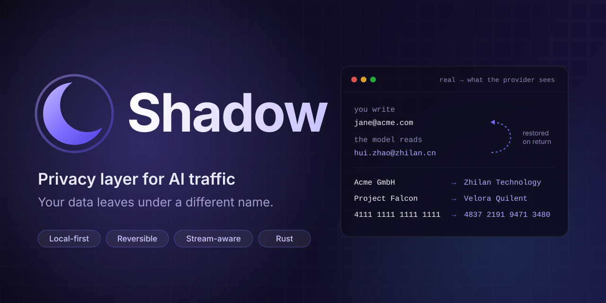
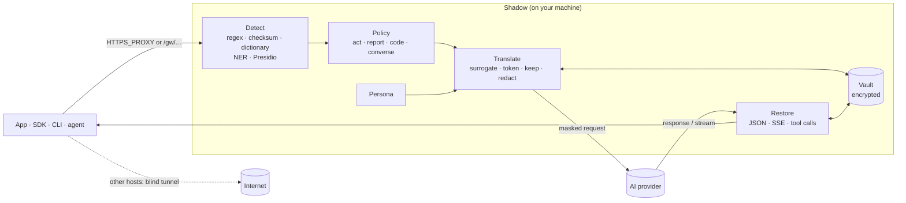

<p align="center">
  
</p>

<p align="center">
  <strong>Shadow masks names, emails, customers and secrets with realistic, reversible fakes before a request reaches an AI provider, then restores them in the answer.</strong>
</p>

<p align="center">
  <a href="LICENSE"></a>
  
  
  <a href="https://getshadow.dev/"></a>
</p>

<p align="center">
  <a href="https://getshadow.dev/"><b>Docs</b></a> ·
  <a href="#quick-start"><b>Quick start</b></a> ·
  <a href="#how-it-works"><b>How it works</b></a> ·
  <a href="#use-it-from-your-app"><b>Integrations</b></a> ·
  <a href="https://getshadow.dev/benchmarks/"><b>Benchmarks</b></a> ·
  <a href="https://getshadow.dev/compare/"><b>Compare</b></a> ·
  <a href="https://getshadow.dev/use-cases/"><b>Use cases</b></a> ·
  <a href="https://getshadow.dev/industries/"><b>Industries</b></a> ·
  <a href="CONTRIBUTING.md"><b>Contributing</b></a>
</p>

---

Shadow is an endpoint privacy layer between your apps and AI clouds: OpenAI, Anthropic, Gemini, Azure OpenAI, OpenRouter, Mistral, Groq and more. It runs on your machine as a local proxy or gateway, or inside your Rust service as a library. It finds sensitive values in every outbound request, swaps them for format-preserving fakes from a persistent **persona**, keeps the mapping in an encrypted local vault, and translates responses back, including streamed responses and tool calls.

```text
you      ──"Summarise this thread: jane@acme.com asks when Project Falcon ships to Acme GmbH"──────────────────────▶ Shadow
Shadow   ──"Summarise this thread: hui.zhao@zhilan.cn asks when Velora Quilent ships to Zhilan Technology Co., Ltd."──▶ provider
provider ──"hui.zhao@zhilan.cn wants a ship date for Velora Quilent…"──────────────────────────────────────────▶ Shadow
Shadow   ──"jane@acme.com wants a ship date for Project Falcon…"────────────────────────────────────────────────▶ you
```

Single Rust binary · Apache-2.0 · no cloud, no account, no telemetry.

## Why

Prompts carry far more than the question: colleagues' names, customer lists, invoices with IBANs, internal hostnames, file paths with your username, API keys pasted by accident. Policies say "don't paste that", and people paste it anyway because the tool is useful.

Most DLP gateways **block**, which breaks the tool, so people route around them. Plain redaction (`<PERSON>`) keeps the request flowing but destroys meaning: the model can't tell two people apart or write to the right address.

Shadow **translates**. A fake email is still an email. A fake card still passes Luhn. A fake IBAN still passes mod-97. The model gets a coherent prompt about a company that does not exist, and you get a useful answer about yours. When the goal is to write to or act on someone ("email Jane", "draft a reply to Jane Doe at Acme GmbH"), Shadow does not fake the recipient, because the model would then greet, research or address the wrong person: the recipient passes through as written and is logged, and everything else in the request stays masked.

## Before and after

| What you send | What the provider sees |
|---|---|
| `jane@acme.com` | `hui.zhao@zhilan.cn` |
| `Acme GmbH` (your organisation) | `Zhilan Technology Co., Ltd.` |
| `Project Falcon` | `Velora Quilent` |
| `4111 1111 1111 1111` | `4837 2191 9471 3480` (valid Luhn) |
| `DE89 3704 0044 0532 0130 00` | another German IBAN (valid mod-97) |
| `/Users/jdoe/src/billing` | `/Users/huizhao/src/billing` |
| `sk-proj-…` (an API key) | a fake key of the same shape, or `[REDACTED_SECRET]` if you opt in |
| 400 customer rows in a report | `[PERSON_0001]`, `[EMAIL_0001]`, … restored in the answer |

The same real value always gets the same fake, and no two real values share one, so restoring is exact. Restoration works on whole fakes and on a fake person's first or last name on its own; other fragments (the last four digits of a card, part of an email) stay fake.

## Features

| | |
|---|---|
| **Reversible, format-preserving fakes** | Emails, phones, names, addresses, IBANs, cards, national IDs, IPs, MACs, hostnames, secrets, paths, from one coherent persona |
| **Three integration modes** | HTTPS proxy for every tool that calls a [supported AI API](https://getshadow.dev/reference/providers/), `/gw/<provider>` gateway with no CA, or the `shadow-core` Rust library |
| **Stream-aware** | Restores SSE and NDJSON streams on the fly, even when a fake is split across events |
| **Agent-safe** | The recipient of an action passes through; other fakes in tool-call arguments are restored on your machine before your tools run |
| **Intent-aware policy** | Classifies requests as `act`, `report`, `code` or `converse` and picks a surrogate, token, keep or redact per value |
| **File masking** | Text, CSV, JSON, HTML, XML; DOCX, XLSX, PPTX masked in place; PDF text extracted and masked |
| **Pluggable detection** | Regex, checksums, your dictionary, local machine facts, an optional local NER model, and Microsoft Presidio |
| **Local and encrypted** | ChaCha20-Poly1305 vault, `0600` key, atomic multi-process writes; the mapping never leaves the machine |
| **Minimal interception** | Only known AI hosts are decrypted; all other traffic is tunnelled byte for byte |
| **Identity scrubbing** | OpenAI `user`, Anthropic `metadata.user_id`, org and OS headers replaced or stripped |
| **Activity dashboard** | Counts by data type, destination and app, never values: web UI on loopback, `shadow top`, and a menu-bar / tray app |

## Quick start

**Install**

```sh
# macOS / Linux
curl -fsSL https://raw.githubusercontent.com/Tiny-Bubble-Company/shadow/main/packaging/install.sh | sh

# Windows (PowerShell)
irm https://raw.githubusercontent.com/Tiny-Bubble-Company/shadow/main/packaging/install.ps1 | iex

# From source (Rust 1.88+)
cargo install --locked --git https://github.com/Tiny-Bubble-Company/shadow shadow-cli

# Docker
docker build -f packaging/Dockerfile -t shadow .
docker run -d --name shadow -p 127.0.0.1:8877:8877 -v shadow-data:/data shadow
```

The install scripts use a release binary when one is published for your platform and otherwise build with `cargo`. They never change system settings.

**Set up and try it offline**

```sh
shadow init --org "Acme GmbH"          # persona + vault key + local CA
echo "Ticket from jane@acme.com (Acme GmbH): card 4111 1111 1111 1111 declined" | shadow mask
# Ticket from tsun@xinghe.cn (Xinghe Technology Co., Ltd.): card 4261 8002 0172 9224 declined
```

**Run it and send a protected request**

```sh
shadow run                             # foreground, 127.0.0.1:8877

# Gateway mode: no certificate needed
export OPENAI_BASE_URL=http://127.0.0.1:8877/gw/openai/v1
export ANTHROPIC_BASE_URL=http://127.0.0.1:8877/gw/anthropic
```

**Cover every tool on the machine that calls an AI API (proxy mode)**

```sh
shadow install            # dry run: prints exactly what would change
shadow install --apply    # background service + trust the local CA + env file
export HTTPS_PROXY=http://127.0.0.1:8877
```

**Verify**

```sh
shadow status             # proxy health, persona, vault, CA fingerprint
shadow identity           # the persona providers see
shadow scan prompt.txt    # what would be masked, without changing anything
```

Full walkthrough: [Quick start](https://getshadow.dev/getting-started/quick-start/).

## Use it from your app

**OpenAI SDK (Python)**

```python
from openai import OpenAI

client = OpenAI(base_url="http://127.0.0.1:8877/gw/openai/v1")
reply = client.chat.completions.create(
    model="gpt-4o-mini",
    messages=[{"role": "user", "content": "Summarise this ticket from jane@acme.com: card declined twice"}],
)
print(reply.choices[0].message.content)   # mentions jane@acme.com; the provider never saw it
```

**OpenAI SDK (Node.js)**

```ts
import OpenAI from "openai";
const client = new OpenAI({ baseURL: "http://127.0.0.1:8877/gw/openai/v1" });
```

**Anthropic SDK**

```python
import anthropic
client = anthropic.Anthropic(base_url="http://127.0.0.1:8877/gw/anthropic")
```

**Any tool that honours a proxy**

```sh
HTTPS_PROXY=http://127.0.0.1:8877 your-tool
```

**Embedded in Rust**

```toml
[dependencies]
shadow-core = { git = "https://github.com/Tiny-Bubble-Company/shadow" }
```

```rust
use shadow_core::{Shadow, ShadowConfig};

let shadow = Shadow::open(
    ShadowConfig::from_dir("/var/lib/myapp/shadow").with_organization(vec!["Acme GmbH".into()]),
)?;

// Simple: realistic surrogates for everything.
let masked = shadow.mask("Ping jane@acme.com about Acme GmbH");
let answer = shadow.unmask(&call_llm(&masked.text)?);

// Per request, with the intent-aware policy and tool calls.
let session = shadow.session_for(&request_json);
session.mask_json(&mut request_json);
let mut response = send(&request_json)?;
session.unmask_json(&mut response);           // tool-call arguments come back real
```

Gateway routes are built in for `openai`, `anthropic`, `openrouter`, `gemini`, `mistral`, `groq`, `together`, `deepseek`, `xai`, `cohere`, `perplexity`, `fireworks` and `cerebras`; add Azure, Bedrock or your own under `[proxy.routes]`. See [Integrations](https://getshadow.dev/integrate/overview/).

## How it works



1. **Intercept.** Shadow listens on `127.0.0.1:8877`. As an HTTPS proxy, it terminates TLS only for known AI hosts, using a local CA you trust once; every other host is tunnelled untouched. As a gateway (`/gw/openai/...`) it needs no CA.
2. **Classify.** Each request gets an intent: `act`, `report`, `code` or `converse`.
3. **Detect.** Built-in detectors, your dictionary, local machine facts and optional NER or Presidio find sensitive spans in every JSON string and uploaded file.
4. **Translate.** Each value gets the treatment the policy picks, by default a stable fake from the persona, recorded in the vault.
5. **Scrub.** Identifying fields and headers are replaced with persona values or removed.
6. **Restore.** Responses, SSE streams and tool-call arguments are translated back before they reach your app.

Details: [How it works](https://getshadow.dev/concepts/how-it-works/).

### Intent-aware policy

"Email jane@acme.com about the renewal": **act**. Shadow finds the recipient phrase (the words after "to", "for" or "at", or right after "email", "call" and similar) and passes the names, emails, phones, companies and addresses in it through as written, each logged, so the model writes to the right person. Everything else in the request (other people, health data, IDs, cards, secrets, hostnames) is masked and restored in the answer and in tool-call arguments on your machine. Set `targets = "surrogate"` to hide the recipient as well: the model sees a stand-in and Shadow restores the real one locally. With a **provider-hosted** tool (hosted MCP, server-side tools) Shadow can't restore values in the provider's cloud, so by default it keeps real what the action needs (the contact details, people, companies, addresses, usernames and IBANs named in the instruction, and for a follow-up that names no email or phone, the emails, phones and people anywhere in the request), keeps secrets, cards and IDs masked, and logs each keep.

"Draft a renewal reminder to Jane Doe (jane@acme.com) at Acme GmbH. Mention that Max Weber approved it": composing a message is **act** too. Jane, her email and Acme GmbH go through; Max Weber is masked and restored in the draft. Requests *about* people that don't contact them (summarise, analyse, report) mask everyone.

"Build a churn report from this customer list": **report** intent. Names, emails and phones become typed tokens such as `[PERSON_0001]` that the model treats as opaque IDs, restored in the answer.

```toml
[policy]
intent = true
[policy.act]
targets = "keep"               # the recipient of a message or action (default); "surrogate" hides it
remote_tool_targets = "keep"   # provider-hosted tools
[policy.report]
person = "token"
email = "token"
default = "surrogate"
[policy.always]
# secret = "redact"            # opt in to irreversible redaction
```

[Read more](https://getshadow.dev/concepts/intent-policy/)

### Files

Multipart uploads, base64 file payloads in JSON (OpenAI `input_file`, Anthropic `document`, Gemini `inline_data`) and `data:` URIs are masked before they leave. Office files stay valid documents; PDF text is sent masked; images pass through (no OCR yet) or can be blocked. [Read more](https://getshadow.dev/concepts/file-masking/)

### Presidio

Shadow can call a [Microsoft Presidio](https://microsoft.github.io/presidio/) Analyzer as an extra detector and merge its findings with its own. Presidio detects; Shadow keeps the fakes, vault and persona. It fails open if Presidio is down.

```sh
docker run -d -p 127.0.0.1:5002:3000 mcr.microsoft.com/presidio-analyzer
```

```toml
[presidio]
enabled = true
url = "http://127.0.0.1:5002/analyze"
```

[Read more](https://getshadow.dev/concepts/detection/#presidio)

## How Shadow compares

| | Blocking DLP gateway | Redaction only (e.g. Presidio anonymizer) | **Shadow** |
|---|---|---|---|
| Request still goes through | No, blocked | Yes | Yes |
| Model sees coherent data | n/a | No, placeholders | Yes, realistic fakes from one persona |
| Answer refers to your real data | n/a | No | Yes, restored |
| Streaming responses | n/a | Usually not handled | Restored on the fly |
| Agents and tool calls | Blocked | Arguments contain placeholders | Arguments restored locally |
| Runs where | Network or cloud | Library or service | On the endpoint, or in-process |
| Non-AI traffic | Often inspected | n/a | Never decrypted |

## Security model

Shadow protects the **content** of AI requests from the provider, its subprocessors, logs, training sets and breaches. It trusts the endpoint it runs on. It does not hide your IP address or the account behind your API key (use `upstream_proxy` to route AI traffic through a relay). Detection is best effort: add your own terms and test with `shadow scan`. Only the [listed AI API hosts](https://getshadow.dev/reference/providers/) are intercepted, so AI web apps in a browser (chatgpt.com, claude.ai, gemini.google.com) are not masked. For actions the provider runs itself, the contact details the action needs are sent real by default and logged. Images are not OCR'd; WebSocket/Realtime APIs and gRPC are not processed; SigV4-signed requests are forwarded unmasked with a warning; certificate-pinning apps reject the local CA in proxy mode.

Read the full [security model](https://getshadow.dev/reference/security/). Report vulnerabilities privately as described in [SECURITY.md](SECURITY.md).

## Documentation

Full documentation: **[getshadow.dev](https://getshadow.dev/)**

- [Benchmarks](https://getshadow.dev/benchmarks/) · [Compare with alternatives](https://getshadow.dev/compare/) · [Use cases](https://getshadow.dev/use-cases/) · [Industries](https://getshadow.dev/industries/) · [By company size](https://getshadow.dev/company-size/)
- [Introduction](https://getshadow.dev/getting-started/introduction/) · [Installation](https://getshadow.dev/getting-started/installation/)
- [Proxy mode](https://getshadow.dev/integrate/proxy-mode/) · [Gateway mode](https://getshadow.dev/integrate/gateway-mode/) · [Embed in Rust](https://getshadow.dev/integrate/rust/) · [Docker and Kubernetes](https://getshadow.dev/integrate/docker-kubernetes/)
- [Configuration](https://getshadow.dev/reference/configuration/) · [CLI](https://getshadow.dev/reference/cli/) · [Providers](https://getshadow.dev/reference/providers/) · [FAQ](https://getshadow.dev/reference/faq/)

The source of the docs is in [`docs-site/`](docs-site/). For LLMs and answer engines, the docs are also published as [`llms.txt`](https://getshadow.dev/llms.txt) and [`llms-full.txt`](https://getshadow.dev/llms-full.txt).

## Roadmap

Release binaries and a published container image, local OCR for images and scanned PDFs, WebSocket/Realtime support, an optional local audit log, more persona regions, and language bindings for `shadow-core`. See the [roadmap](https://getshadow.dev/project/roadmap/).

## Repository layout

```text
crates/shadow-core    detection, persona, vault, policy, translation
crates/shadow-proxy   CA, forward proxy, gateway, files, SSE translation
crates/shadow-cli     the `shadow` binary
apps/shadow-tray      menu-bar / tray app for the activity dashboard
bench/                detection benchmark
ml/                   optional PyTorch NER sidecar
packaging/            install scripts, launchd / systemd / Windows service, Dockerfile
docs-site/            documentation site (Starlight)
```

## Support

Questions about installing, configuring or rolling out Shadow: [support@getshadow.dev](mailto:support@getshadow.dev). Bugs and feature requests: [GitHub issues](https://github.com/Tiny-Bubble-Company/shadow/issues). Security vulnerabilities: see [SECURITY.md](SECURITY.md).

## Contributing

Contributions are welcome: detectors, provider formats, docs, tests. See [CONTRIBUTING.md](CONTRIBUTING.md). In short:

```sh
cargo test --workspace
cargo clippy --workspace --all-targets -- -D warnings
cargo fmt --all
```

This project follows the [Contributor Covenant](CODE_OF_CONDUCT.md).

## License

Apache-2.0. See [LICENSE](LICENSE).
