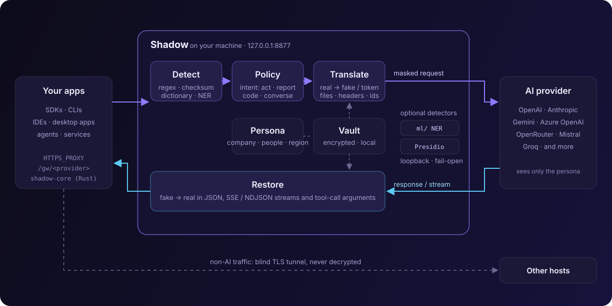

Shadow has three parts:

- **`shadow-core`** (library): detection, persona, vault, intent policy and translation. Everything that touches real values.
- **`shadow-proxy`** (library): the HTTP(S) forward proxy, the `/gw` gateway, the local CA, file handling and the streaming translator.
- **`shadow-cli`** (the `shadow` binary): setup, service installation, inspection tools.

## Life of a request

### 1. Intercept

Shadow listens on `127.0.0.1:8877`.

- **Gateway**: the app sends `POST /gw/openai/v1/chat/completions` in plain HTTP on loopback. Shadow maps the route to `https://api.openai.com/v1/chat/completions`.
- **Proxy**: the app sends `CONNECT api.openai.com:443`. Because the host is on the intercept list, Shadow completes the TLS handshake itself with a leaf certificate minted by the local CA, then reads the HTTP request inside. For any host not on the list, Shadow opens a raw TCP tunnel instead and never sees the plaintext.

### 2. Prepare the body

Shadow decodes `gzip` or `deflate` request bodies, drops hop-by-hop headers and `accept-encoding` (so the response arrives uncompressed and can be translated), and looks at the content type:

- **JSON** is parsed and handled field by field.
- **`multipart/form-data`** uploads, and base64 files embedded in JSON, go through [file masking](/shadow/concepts/file-masking/).
- **Requests signed with AWS SigV4** are forwarded unmodified with a warning, because changing the body would break the signature.

### 3. Classify intent

With `[policy] intent = true` (the default), Shadow classifies the request as `act`, `report`, `code` or `converse` from the instruction, the tools offered and the shape of the data. The class decides the treatment of each detected value: a surrogate, a typed token, the real value, or a redaction. See [Intent-aware policy](/shadow/concepts/intent-policy/).

### 4. Detect

Every string leaf of the JSON body is scanned, apart from protocol keys (`model`, `role`, `type`, `id`, `tool_call_id`, and similar). Each string goes through every enabled detector:

- built-in regex and checksum detectors (emails, phones, cards, IBANs, national IDs, IPs, MACs, hostnames, secrets, paths, names, addresses);
- the dictionary of your organisation names and terms;
- local machine facts (OS user, hostname, git identity);
- optional: the local NER sidecar and [Presidio](/shadow/concepts/detection/#presidio).

Overlapping findings are resolved: the longest span wins, then the higher-priority kind (secrets first, then organisation terms, emails, financial IDs, names). Values on `allow_terms`, and values that are already fakes, are skipped.

### 5. Translate

Each finding gets the treatment chosen by the policy. The default is a **surrogate**: a format-preserving fake from the [persona](/shadow/concepts/personas/), stored in the [vault](/shadow/concepts/vault/). The same real value always gets the same fake, and a fake is never reused for a different real value, so reversal is exact.

### 6. Scrub identifiers

- JSON fields `user`, `safety_identifier` (OpenAI) and `metadata.user_id` (Anthropic) are replaced with the persona's user id.
- Headers in `strip_headers` are removed: by default `OpenAI-Organization`, `X-Forwarded-For`, `X-Real-IP`, `Forwarded`, `Via`, `X-Client-IP` and the `x-stainless-*` OS and runtime headers.
- Headers in `persona_headers` are rewritten when present, for example `X-Request-Origin` becomes the persona hostname.

### 7. Forward

The masked request goes to the provider over TLS (rustls), directly or through `upstream_proxy`. Shadow logs one line per request with the method, URL and number of values masked. It never logs values.

### 8. Restore

- **JSON responses**: every string leaf is unmasked, including tool-call arguments.
- **Streams** (`text/event-stream` and NDJSON): see below.
- **Other content types** pass through unchanged.

## Streaming hold-back

LLM APIs stream text as many small JSON events. A fake such as `Wei Zhang` can arrive as `"Wei"` in one event and `" Zhang"` in the next, so byte-level replacement would miss it.

Shadow parses each event and routes the *delta text fields* of known formats (OpenAI Chat Completions and Responses, Anthropic Messages, Gemini, Cohere, Ollama-style NDJSON) through a per-channel `StreamUnmasker`. A channel is one content stream, such as one choice's text or one tool call's arguments. The unmasker holds back at most *longest fake − 1* bytes, the minimum needed to recognise a fake that is still arriving, and emits everything before that immediately. When the channel ends, the held text is flushed into the closing event (or a synthesized copy of the channel's last event).

The effect is that tokens keep streaming at the same pace, delayed by at most a few characters, and the concatenated output is exactly what unmasking the whole text would produce. Other string fields in events are unmasked directly.

## What is not processed

- Non-AI hosts in proxy mode: tunnelled, never decrypted.
- Images (passed through by default; no OCR), audio, WebSocket and Realtime APIs, and gRPC.
- SigV4-signed requests (AWS Bedrock with IAM signing). Bedrock with bearer API keys is masked normally.

See the [security model](/shadow/reference/security/) for the full list of limitations.
